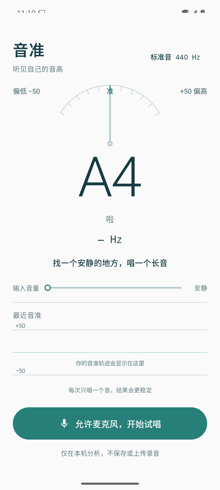

# 音准 · Pitchkeeper

一款在 Android 手机上运行的人声音高测量工具。唱一个长音，立即看到音名、频率以及偏高或偏低多少音分。

<p align="center">
  
</p>

Android 8.0+ · 单音人声测量 · 音频只在设备本地处理

## 下载与安装

首个公开版本的 APK 发布在 [GitHub Releases](https://github.com/winfred97/pitchkeeper-android/releases/latest) 页面。

1. 从 Releases 下载 `Pitchkeeper-v0.1.0.apk`。
2. 在手机上允许浏览器或文件管理器“安装未知来源应用”。
3. 安装后打开应用，允许麦克风权限，再点击“开始试唱”。

> GitHub 直接分发的是 Android 安装包，不经过应用商店审核。请只从本仓库的 Releases 下载。

## 功能

- 测量 C2–C6 范围内的单音人声
- 显示音名、唱名、频率和音分偏差
- 音准弧针、输入音量与最近音准轨迹
- 440 / 442 / 415 Hz 标准音切换
- 退到后台时释放麦克风，回到前台后可恢复测量
- 不联网、不保存或上传录音、不申请存储权限

## 使用建议

- 戴耳机可减少伴奏被麦克风收进去。
- 保持手机约 20–30 厘米，唱“啊——”并维持两秒。
- 环境越安静、一次只唱一个音，结果越稳定。
- 真机麦克风的降噪和自动增益因品牌而异；当前版本仍需更多真机试唱验证。

## 开发与构建

用 Android Studio 打开本目录并运行 `app`，或在安装 JDK 17 与 Android SDK 35 的机器上执行：

```bash
./gradlew :app:testDebugUnitTest :app:assembleDebug
```

调试 APK 输出在 `app/build/outputs/apk/debug/app-debug.apk`。调试签名不能用于正式发布。

正式 Release 必须提供以下环境变量后再执行 `:app:assembleRelease`：

```text
PITCHKEEPER_STORE_FILE
PITCHKEEPER_STORE_PASSWORD
PITCHKEEPER_KEY_ALIAS
PITCHKEEPER_KEY_PASSWORD
```

密钥文件和密码不提交到仓库。

## 验证状态

- 26 个 JVM 单元测试通过
- 3 个 Android 15 模拟器 Compose 界面测试通过
- 已验证模拟器麦克风权限、录音启动与释放
- 合成音测试目标为 ±5 音分

这些结果不能替代实体手机上的真实人声精度、延迟与兼容性测试。

## 隐私

应用只在用户主动开始后读取麦克风，并在内存中实时分析。详见 [隐私说明](PRIVACY.md)。

## 请我喝杯咖啡

如果「音准」对你的练习有帮助，欢迎请我喝杯咖啡，支持后续维护和真机适配。

<p align="center">
  <a href="docs/sponsor/coffee-qr.png">
    
  </a>
</p>

微信扫码，金额随意；赞助完全自愿，不影响任何功能。收款码图片不会被打包进 Android 应用。

## 许可证

源码采用 [MIT License](LICENSE)。
